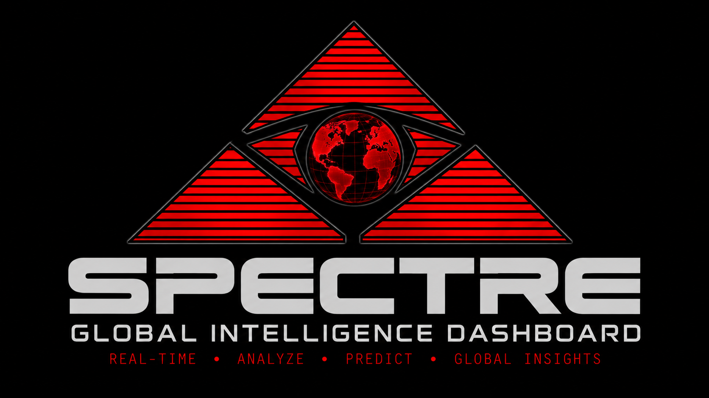
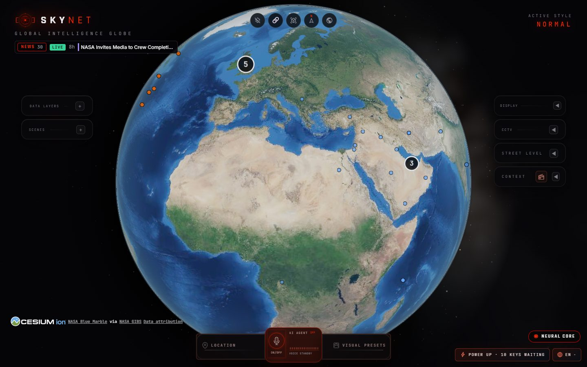
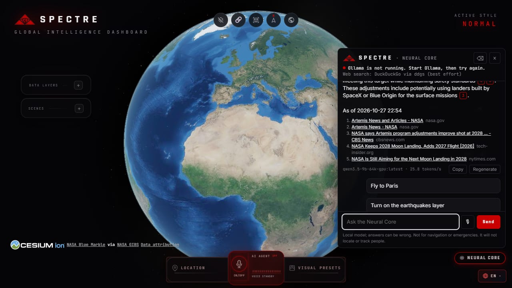
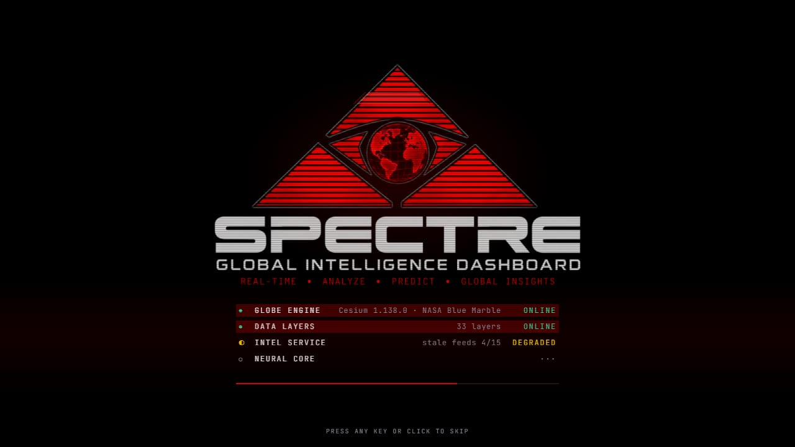

<p align="center"></p>

# SPECTRE — Global Intelligence Dashboard

**A local-first global intelligence dashboard.** Live flights, satellites, weather, cameras and public data on a 3D Earth, with real-time news intelligence and a local AI analyst, the Neural Core, all running on your own machine with no paid keys required.



SPECTRE is a fork of [God's Eye View](https://github.com/bilawalsidhu/gods-eye-view) (MIT, © Bilawal Sidhu), rebranded with the SPECTRE emblem in black and red. It keeps God's Eye View's layers and tools, except where their data could not be redistributed. [NOTICE.md](NOTICE.md) lists every change from upstream.

> **Status: v0.1.0** (tagged locally as `skynet-v0.1.0`, under the product's earlier name). All six phases of [docs/ADR-001.md](docs/ADR-001.md) are done. What was verified and what was not is in [docs/VERIFY.md](docs/VERIFY.md).

> **Renamed.** SPECTRE was called SKYNET until 2026-10-28. Settings named `SKYNET_*` and `scripts\skynet.ps1` still work for one release, with a warning, and the intel database and tool logs are copied to their new names on the first start. [CHANGELOG.md](CHANGELOG.md) lists every change.

## What it does

- **The globe.** God's Eye View's layers, in two groups:
  - **Without keys:** flights within 250 nm of the view, military flights, satellites, earthquakes, wildfires, weather, traffic cameras and transit, and more.
  - **With keys:** Google Photorealistic 3D tiles, vessels and fire detections, among others.
- **News intelligence.** A local service (`intel/`) reads open news feeds and GDELT, removes duplicates and places stories on the map. The **News** layer, ticker and panel show them with their source, link and freshness, and **Natural Events** shows NASA EONET events. Only headline, a short summary, source, link and time are kept.
- **The Neural Core.** A chat analyst that runs on [Ollama](https://ollama.com) on your machine.
  - **What it can do.** It moves the globe and switches layers, searches the local news store, and checks the web when a question needs it. Every news or web answer cites its sources and ends with "As of".
  - **What it refuses.** It will not locate or profile people.
  - **When Ollama is not running,** the panel says so.
  - **Cloud models, if you choose.** A conversation can use Claude, ChatGPT, OpenRouter, NVIDIA NIM, DeepSeek or your own OpenAI-compatible server instead, with your API key and after you allow it. Local-only mode blocks them all. See [docs/KEYS_AND_COSTS.md](docs/KEYS_AND_COSTS.md).

  
- **Boot overlay.** While the app loads, the emblem shows four status rows from real checks: the globe's first frame, the layer catalog, the intel service and the Neural Core. Any key or click skips it; Display ▸ Boot animation makes it short or turns it off.

  
- **Local voice (optional).** Hold the mic in the Neural Core panel and ask. Speech is recognised and spoken on your computer (faster-whisper and Kokoro); the answer is read aloud in English as it arrives.

## Quick start (Windows 11, PowerShell)

1. **Install the tools,** each once.
   - Node.js 24.14 or newer, from [nodejs.org](https://nodejs.org).
   - [uv](https://docs.astral.sh/uv/), for the Python service:

     ```powershell
     winget install --id=astral-sh.uv -e
     ```
   - [Ollama](https://ollama.com/download), for the Neural Core.

   Then open a new PowerShell window.
2. **Get a chat model** that supports tool calling, then name it in a `.env` file in the repository root (copy [.env.example](.env.example)):
   - **About 8 GB of GPU memory:**

     ```powershell
     ollama pull qwen3.5:9b
     ```
     then set `OLLAMA_MODEL=qwen3.5:9b`.
   - **Less memory:**

     ```powershell
     ollama pull bonsai-2:9b
     ```
     then set `SPECTRE_LOW_RESOURCE=1`.

   The built-in default, `qwen3.5-9b-64k-gpu:latest`, is the developer's local build of Qwen 3.5 9B, so set `OLLAMA_MODEL` on any other machine. The public `qwen3.5:9b` and `bonsai-2:9b` tags exist in the Ollama library, but the developer measured only the local build and `bonsai-2:9b` ([eval](docs/phase4/neural-core-eval.md)). Check yours with `npm run doctor`: it reports whether the model is installed and can call tools.
3. **Check the setup.** It reports Node, the keys you have, the intel service, Ollama and your model, web search, local voice, GPU memory, and any service reachable from your network:

   ```powershell
   npm run doctor
   ```
4. **Start SPECTRE.** This starts the intel service and the web app together; Ctrl+C stops both. The first run sets up the Python environment and runs `npm ci`:

   ```powershell
   .\scripts\spectre.ps1
   ```
5. **Open** http://localhost:4173.

**Optional local voice:** this installs speech recognition and synthesis and fetches about 270 MB of pinned models:

```powershell
.\scripts\spectre.ps1 -Voice
```

If PowerShell says running scripts is disabled (Windows' default policy is Restricted), allow local scripts for your account once:

```powershell
Set-ExecutionPolicy -Scope CurrentUser RemoteSigned
```

## Keyless and keyed

Everything below "Without keys" works out of the box. Keys go in **Provider Settings** (the POWER UP chip, bottom right), which writes your local `.env`. Neural Core chat keys are the exception: its NEURAL CORE CHAT KEYS section stores them in the OS keyring.

| Feature | Without keys | With a key |
|---|---|---|
| Basemap | NASA Blue Marble from GIBS: cloud-free but soft below about 600 m per pixel. Esri imagery is a choice, under Esri's terms | Google Photorealistic 3D Tiles (`GOOGLE_MAPS_API_KEY`, or `CESIUM_ION_TOKEN` through Cesium ion) |
| Flights | adsb.lol within 250 nm of the view | Worldwide OpenSky (Non-commercial sources switch; OpenSky credentials optional) |
| Vessels | off | AISStream (`AISSTREAM_API_KEY`) |
| Active fires | off | NASA FIRMS (`FIRMS_MAP_KEY`) |
| Traffic flow | built-in simulation | TomTom (`TOMTOM_API_KEY`) |
| Street level | KartaView and Panoramax | Mapillary (`MAPILLARY_CLIENT_TOKEN`), Google Street View (`GOOGLE_MAPS_SERVER_API_KEY`) |
| Cloud voice (God's Eye View's) | off | OpenAI (`OPENAI_API_KEY`) or Gemini (`GEMINI_API_KEY`) |
| Neural Core web search | DuckDuckGo results through `ddgs`, best effort | Your SearXNG (`SEARXNG_URL`), Brave (`BRAVE_API_KEY`) or Tavily (`TAVILY_API_KEY`) |
| Neural Core and local voice | run on your machine | — |
| Neural Core with a cloud model | — | Claude (`ANTHROPIC_API_KEY`), ChatGPT (`OPENAI_API_KEY`), OpenRouter (`OPENROUTER_API_KEY`), NVIDIA NIM (`NVIDIA_API_KEY`) or DeepSeek (`DEEPSEEK_API_KEY`), billed per token by them |

## Costs

SPECTRE itself is free, and its default setup needs no paid service: the Neural Core and local voice run on your own hardware. Keyed providers have their own free tiers and prices, which change; check them before adding a key. For the Neural Core's cloud models, [docs/KEYS_AND_COSTS.md](docs/KEYS_AND_COSTS.md) explains what a turn costs and the budget that guards it.
- [Google Maps Platform](https://mapsplatform.google.com/pricing/)
- [Cesium ion](https://cesium.com/pricing/)
- [OpenAI API](https://openai.com/api/pricing/)
- [Claude API](https://claude.com/pricing), [OpenRouter](https://openrouter.ai/models), [DeepSeek API](https://api-docs.deepseek.com/quick_start/pricing) and [NVIDIA's API catalog](https://build.nvidia.com/), for the Neural Core's cloud models
- [Gemini API](https://ai.google.dev/pricing)
- [TomTom](https://developer.tomtom.com/pricing)
- [Brave Search API](https://brave.com/search/api/)
- [Tavily](https://tavily.com)
- [AISStream](https://aisstream.io)
- [NASA FIRMS](https://firms.modaps.eosdis.nasa.gov/api/)

## Data you have to opt in to

Some free sources allow only personal, non-commercial use, so SPECTRE leaves them off:

- **Non-commercial sources switch** (Provider Settings). It turns on:
  - worldwide OpenSky flights, Open-Meteo cockpit weather, Google News headlines and adsbdb flight routes;
  - the news feeds whose terms are personal-use or unchecked (UN News, BBC, Al Jazeera and others in `intel/feeds.default.yaml`).

  It writes `SPECTRE_NONCOMMERCIAL_SOURCES=1` to your local `.env`.
- **Submarine cables** (TeleGeography, CC BY-NC-SA) are not shipped. For personal use, run:

  ```powershell
  .\scripts\fetch-optional-data.ps1 -AcceptNonCommercialLicense
  ```
- **Local voice** installs GPL-3.0 components (espeak-ng and phonemizer, pulled in by Kokoro), so it is never installed by default ([NOTICE.md](NOTICE.md)).

[DATA_SOURCES.md](DATA_SOURCES.md) lists every source, its terms and its attribution.

## Security and privacy

- **What runs where.**
  - The intel service listens on 127.0.0.1 only; the web app on `localhost` unless you turn on LAN sharing.
  - The browser reaches the intel service only through the app's own proxy, which refuses other sites.
- **What stays on your machine.**
  - Chat history is stored locally. With a cloud model selected, each turn sends that provider the conversation, the tool results and, if you allow it, the map view; you consent per provider first.
  - The tool log in `.spectre-logs/` records which tools ran and which URLs were read, never page content.
  - Voice recordings are never stored.
- **What the model can and cannot do.**
  - Pages the model reads go through an SSRF guard: public addresses only, robots.txt honoured, capped in size and time.
  - The model has no shell, file or code tools.
- **Ollama's own setting.** If `npm run doctor` warns that Ollama answers on your network address, Ollama is reachable from other machines with no authentication; turn that off in Ollama's settings unless you need it.

The full checklist, with evidence, is in [docs/phase6/security-checklist.md](docs/phase6/security-checklist.md).

## Responsible use

SPECTRE models **events, assets, infrastructure and systems**: aircraft, vessels, satellites, fires, cameras, cities. It does not search for, recognise or track individual people, and contributions that cross that line will not be merged.

It is not for navigation, emergency response or any other safety-critical use. Data comes from public feeds that can be late, incomplete or wrong, and the Neural Core's answers, from a local or a cloud model, can be wrong.

## Documentation

- [docs/ARCHITECTURE.md](docs/ARCHITECTURE.md): how the pieces fit, ports, trust boundaries and GPU budget.
- [docs/VERIFY.md](docs/VERIFY.md): manual verification steps and their results.
- [docs/API.md](docs/API.md): the intel service API.
- [docs/ADR-001.md](docs/ADR-001.md): the design and its decisions.
- [docs/ADR-002-providers.md](docs/ADR-002-providers.md): the Neural Core's chat providers.
- [docs/KEYS_AND_COSTS.md](docs/KEYS_AND_COSTS.md): chat provider keys, where they are kept, and what turns cost.
- [docs/VERIFY_PROVIDERS.md](docs/VERIFY_PROVIDERS.md): how to check a chat provider live, and what has been verified.
- [docs/BRANDING.md](docs/BRANDING.md): the SPECTRE emblem, its files and how to use them.
- [CONTRIBUTING.md](CONTRIBUTING.md): how to change SPECTRE.
- [DATA_SOURCES.md](DATA_SOURCES.md): data sources and their terms.
- Measurements:
  - [docs/phase4/neural-core-eval.md](docs/phase4/neural-core-eval.md): the Neural Core eval.
  - [docs/phase5/voice-latency.md](docs/phase5/voice-latency.md): local voice latency.

## Licence

The code is MIT ([LICENSE](LICENSE)), which covers code only. Bundled data, 3D models and fonts keep their own licences; see [DATA_SOURCES.md](DATA_SOURCES.md), [public/models/README.md](public/models/README.md) and [THIRD_PARTY_NOTICES.md](THIRD_PARTY_NOTICES.md).

Upstream's full README, with its feature walkthrough and key setup, is archived at [docs/upstream/GODS-EYE-VIEW-README.md](docs/upstream/GODS-EYE-VIEW-README.md).
