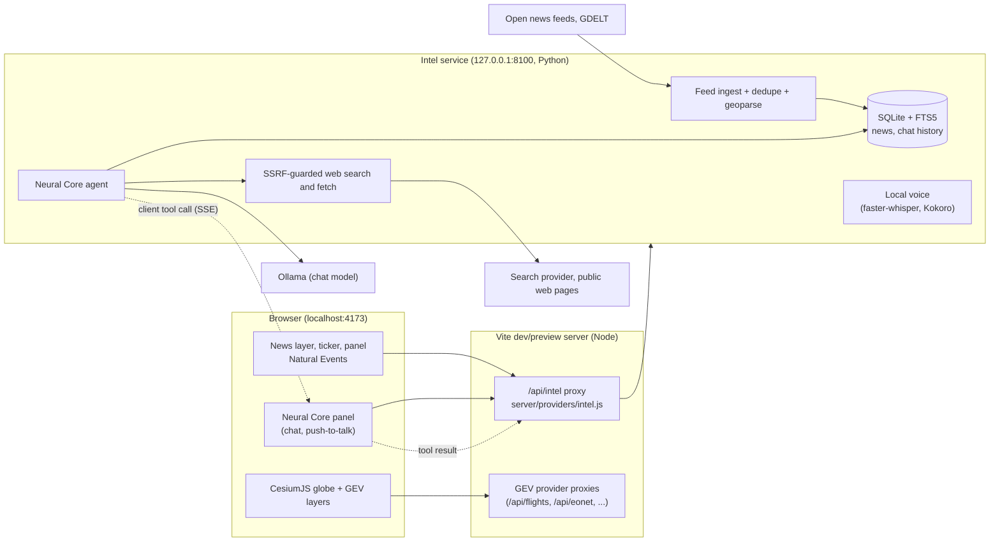

# SPECTRE architecture

How SPECTRE's parts fit together, where data flows, and where the trust boundaries are. The decisions behind them are in [ADR-001.md](ADR-001.md). God's Eye View's own architecture (layers, voice, scenes) is described in [APPLICATION.md](APPLICATION.md) and [CODE-BOUNDARIES.md](CODE-BOUNDARIES.md).

## Processes and ports

| Process | Address | Started by |
|---|---|---|
| Web app (Vite dev server; `vite preview` in CI) | `localhost:4173` (LAN only if you turn on GEV's LAN sharing) | `scripts\spectre.ps1` or `npm run dev` |
| Intel service (FastAPI, Python 3.12 via uv) | `127.0.0.1:8100` (`SPECTRE_INTEL_URL` may move the port, never the host) | `scripts\spectre.ps1` (or `-IntelOnly`) |
| Ollama | `OLLAMA_HOST`, default `127.0.0.1:11434` | the Ollama app; not managed by SPECTRE |

The browser talks only to `localhost:4173`. Its Content Security Policy is same-origin for connections it makes to the app, so every intel request goes through the proxy.

## Data flows

### News

1. **Ingest.** The scheduler in `intel/app/ingest/` polls the feeds in `intel/feeds.default.yaml`, plus your `feeds.local.yaml`, and GDELT, every 5 minutes with conditional requests. Feeds whose terms are personal-use or unchecked poll only when the Non-commercial sources switch is on.
2. **Clean up.** Stories are normalised, classified, de-duplicated (URL, then fuzzy title) and placed: spaCy named-entity recognition matched against the bundled GeoNames gazetteer (`intel/app/geo/`).
3. **Store.** Only headline, short summary, source, URL and timestamps are stored, in SQLite with an FTS5 index (`intel/app/store/news.py`), and kept for 30 days.
4. **Serve.** `GET /api/intel/news` pages and filters the stories, and `GET /api/intel/news/stream` pushes new ones over SSE (`intel/app/hub.py`). The News layer (`src/layers/news/`) draws them, with freshness (live, stale, offline).
5. **Natural Events** come from NASA EONET through GEV's provider proxy (`server/providers/eonet.js`), not the intel service.

### A Neural Core turn

1. **Send.** The panel (`src/neuralCore/panel.js`) posts the question with a snapshot of the view and the enabled layers to `POST /api/intel/chat`. The reply is an SSE stream.
2. **Refuse or prepare.** The agent (`intel/app/chat/agent.py`) refuses person lookups first (`policy.py`). It then builds the system prompt with the map context and calls Ollama's `/api/chat` with the tool schemas from `shared/tools/neural-core.tools.json`.
3. **Tool rounds,** at most 4:
   - **Server tools** run in the intel service: news search, news near a place, web search, page fetch, layer state, viewport. Web and news text goes back to the model wrapped as untrusted data, with numbered sources.
   - **Globe tools** (fly, zoom, layers, styles, tracking, annotations) go to the browser as a `client_tool` event. The panel runs them through GEV's own action runner (`src/neuralCore/executor.js`, the same path voice uses) and posts the result to `POST /api/intel/chat/tool-result`. The agent waits up to 15 s. A refused action is reported as a failure.
4. **Answer.** Tokens stream to the panel. The `done` event carries citations, "As of" (when news or web was used), the model and tokens per second.
5. **Record.** History is stored in SQLite (`intel/app/store/chat.py`). Tool calls and fetched URLs, never content, go to `.spectre-logs/tools-YYYYMMDD.jsonl`.

The tool schemas are generated from two sources:
- **Client half:** from `src/tools/registry.js`, by `npm run tools:export`.
- **Server half:** from `intel/app/chat/tools.py`, by `intel/scripts/export_tools.py`.

Tests on both sides fail when the shared file is stale.

### Local voice (optional)

1. **Record.** The mic opens on press and closes on release (`src/neuralCore/voice.js`, `voiceControl.js`). The recording is posted once to `POST /api/intel/voice/transcribe`.
2. **Transcribe.** faster-whisper `base` turns it into text on the CPU (`intel/app/voice/`), and the panel sends that text as an ordinary chat turn.
3. **Speak.** The streamed answer is split into sentences. Each goes to `POST /api/intel/voice/speak` (Kokoro-82M on the CPU), with at most two requests out at once. The WAV is played with Web Audio.
4. **Load.** The models load once, in the background, when the service starts. They are fetched only by `scripts\spectre.ps1 -Voice`, checked against pinned SHA-256 hashes.

## Trust boundaries

| Boundary | Guard |
|---|---|
| Other websites → the proxy | Writes need this page's own Origin. Chat and voice answer this machine only. `SPECTRE_CHAT_ALLOW_LAN=1` opens chat, never voice. Bodies are limited to each route's type and size. |
| The proxy → the intel service | Loopback only. Origin, cookies and credentials are never forwarded. |
| Anything else → the intel service | Requests carrying an Origin or a cross-site fetch marker are refused (403). A Host allowlist blocks DNS rebinding (400). |
| The model → the web | `intel/app/web/guard.py` (53 tests): • http(s) on ports 80 and 443 only, no credentials in the URL; • every DNS answer must be public, and the connection goes to the address that was checked; • each redirect is re-checked (at most 3); • robots.txt is honoured; at most 10 s, 1 MB, text types only. |
| Web content → the model | Wrapped as `<untrusted_web_content>`; it never becomes instructions. |
| The model → your machine | No shell, file or code tools exist. Globe tools are limited to the registry and validated against their schema twice, by the service and in the browser. |
| People | Person lookups are refused before the model runs; web search queries get the same check. |

## Storage

| Path | Contents | In git |
|---|---|---|
| `intel/data/spectre.db` | News stories, feed state, chat history | no |
| `intel/data/voice/` | Pinned voice models (opt-in) | no |
| `.spectre-logs/` | Tool log (URLs, no content); the intel service's log when started by `spectre.ps1` | no |
| `.env` | Keys and settings (owner-only permissions, set by Provider Settings) | no |
| `shared/tools/neural-core.tools.json` | Generated tool schemas | yes |

## GPU and memory budget

Measured on an RTX 5060 Laptop GPU (8 GB) with 16 GB RAM ([phase4/neural-core-eval.md](phase4/neural-core-eval.md), [phase5/voice-latency.md](phase5/voice-latency.md)):

| Component | Memory |
|---|---|
| `qwen3.5-9b` chat model (default) | 6.68 GB loaded, 5.39 GB of it on the GPU (about 19% on the CPU) |
| `bonsai-2:9b` (low-resource mode) | 3.36 GB, all on the GPU |
| Cesium (browser) | On this machine it drew on the Intel iGPU, using no RTX memory. A browser on the RTX shares its 8 GB with the model; not measured. |
| Local voice | CPU only, 8 threads each for speech to text and text to speech. RAM not measured. |

`SPECTRE_LOW_RESOURCE=1` picks the smaller model, an 8k context and smaller history, web and page budgets. A reduced tool subset and reduced layer density are not built; GEV's Density control is the manual knob.

## Where SPECTRE's code lives

SPECTRE keeps its own code apart so that `git merge upstream/main` stays tractable. Changes to upstream files are registration points, marked `SPECTRE`.

| Area | Paths |
|---|---|
| Intel service | `intel/` (`app/ingest`, `app/geo`, `app/store`, `app/web`, `app/chat`, `app/voice`, `app/api`; tests in `intel/tests`) |
| Proxy | `server/providers/intel.js` |
| News and Natural Events layers | `src/layers/news/`, `src/layers/eonet/` |
| Neural Core panel | `src/neuralCore/` |
| Tool registry | `src/tools/registry.js`, `shared/tools/` |
| Branding and theme | `src/branding.js`, `src/theme/` |
| Basemap default | `src/maps/catalog.js` (`KEYLESS_DEFAULT_STACK_ID`), `src/maps/imagery.js` |
| Scripts | `scripts/spectre.ps1`, `scripts/spectre-doctor.mjs`, `scripts/qa-spectre-news.mjs`, `scripts/qa-neural-core.mjs`, `scripts/bench-local-voice.mjs` |
